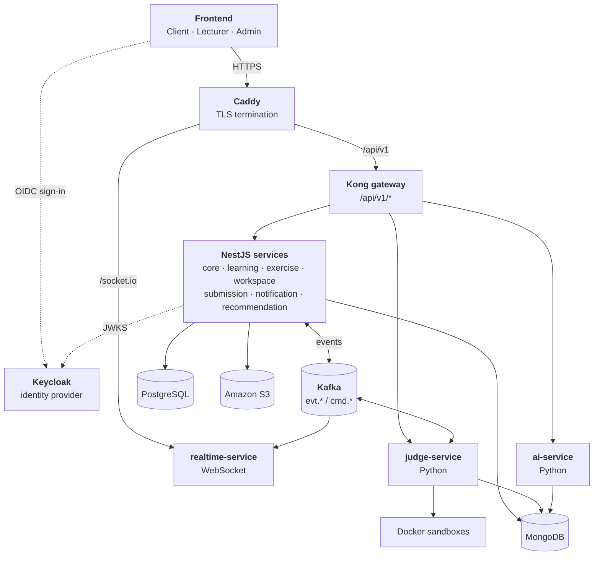
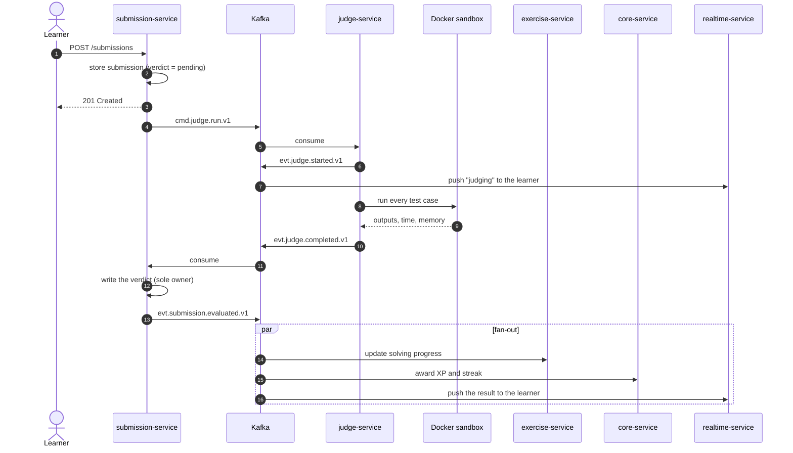
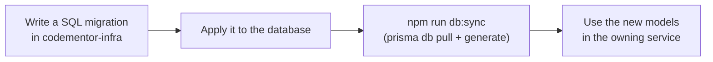
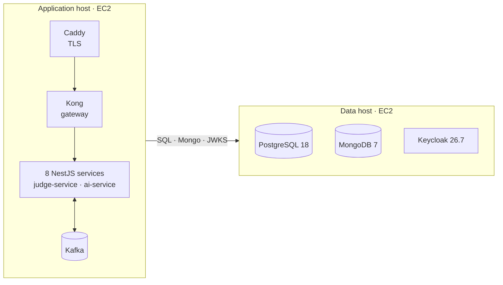

<div align="center">

<picture>
  <source media="(prefers-color-scheme: dark)" srcset=".github/assets/logo-dark.png">
  
</picture>

<h1>CodeMentor Backend</h1>

<p>
  <strong>Service-based backend for CodeMentor</strong> — a programming-learning platform with courses,
  learning paths, auto-graded coding practice, study groups, paid courses and AI assistants.
</p>

<p>
  
  
  
  
  
  <br>
  
  
  
  
  
</p>

<p>
  <a href="https://codementor.cloud"><strong>Live app</strong></a> ·
  <a href="docs/02-service-architecture.md">Architecture</a> ·
  <a href="#getting-started">Getting started</a> ·
  <a href="#contributing">Contributing</a>
</p>

</div>

---

## Table of contents

1. [About](#about)
2. [Features](#features)
3. [Architecture](#architecture)
4. [Services](#services)
5. [Tech stack](#tech-stack)
6. [Getting started](#getting-started)
7. [Configuration](#configuration)
8. [Development workflow](#development-workflow)
9. [Database](#database)
10. [Authentication and authorization](#authentication-and-authorization)
11. [Messaging with Kafka](#messaging-with-kafka)
12. [Deployment](#deployment)
13. [Project structure](#project-structure)
14. [Documentation](#documentation)
15. [Contributing](#contributing)
16. [Related repositories](#related-repositories)

## About

CodeMentor helps learners study programming at their own pace and practise with instant,
automatic feedback. Lecturers publish courses and exercises and earn revenue from paid courses;
administrators moderate content and run the platform.

This repository contains every server-side component: **ten independently deployable services**
(eight NestJS, two Python) behind a single API gateway. They share one PostgreSQL database in which
**every table has exactly one owning service**, and they talk to each other over HTTP when an
answer is needed immediately and over Kafka for everything else.

| | |
| --- | --- |
| **Production** | Client [codementor.cloud](https://codementor.cloud) · Lecturer [lecturer.codementor.cloud](https://lecturer.codementor.cloud) · Admin [admin.codementor.cloud](https://admin.codementor.cloud) |
| **Identity** | Keycloak at [id.codementor.cloud](https://id.codementor.cloud) |
| **API** | One origin — the Kong gateway at `/api/v1`, plus `/socket.io` for realtime updates |

## Features

| Area | What the backend provides |
| --- | --- |
| **Learning** | Learning paths, courses, chapters and lessons (video, theory, exercise); enrollment; progress that unlocks lessons in sequential, graph or free mode; course reviews; articles |
| **Practice** | Exercise catalog and sets, topics, stdin/stdout and function-style exercises, hidden and public test cases, hints, solving progress and history |
| **Code judging** | Submissions graded in isolated Docker sandboxes for **8 languages** (Python, C, C++, Java, JavaScript, TypeScript, Go, PHP), with time and memory limits |
| **Study groups** | Groups with invite codes, owner/deputy/member roles and per-member permissions, shared documents, assignments with review, activity feed, chat |
| **AI assistants** | **Codey** (coding help in the solve screen), **Lecter** (authoring assistant for lecturers), **Tutor** (answers grounded in group documents, with citations), AI test-case suggestions |
| **Commerce** | Paid courses, VNPAY/MoMo payments (sandbox), a double-entry ledger, lecturer revenue, holds, payouts, refunds and reconciliation |
| **Notifications** | In-app notifications over WebSocket, email via SMTP or Amazon SES, study and deadline reminders |
| **Moderation** | Content reports with a submit cooldown, a moderation history with rollback, timed account suspension, an audit log, announcements |
| **Recommendations** | Personalised course and learning-path suggestions from learning preferences and activity |

## Architecture



**Design rules**

- **One owner per table.** A service writes only its own tables; it reads others through HTTP or
  read-only views. Writing another service's table is never allowed.
- **Synchronous calls follow one direction:** `core` ← `exercise` ← `learning` / `workspace` /
  `submission`. Calls the other way go through Kafka, so dependency cycles cannot appear.
- **Workers own no state.** `judge-service` and `ai-service` receive everything in the request or
  message and return a result; the owning service decides what to store.

The full design — ownership tables, topic catalog, envelope, partition keys and rollout order — is
in [`docs/02-service-architecture.md`](docs/02-service-architecture.md).

### Example flow: submitting a solution



## Services

| Service | Port | Language | Responsibility |
| --- | --- | --- | --- |
| `core-service` | 3001 | NestJS | Accounts and profiles, roles, catalog (technologies, tags, companies), audit log, content reports and moderation, suspensions, announcements |
| `learning-service` | 3002 | NestJS | Learning paths, courses, chapters, lessons, articles, enrollment and progress, reviews, commerce (orders, ledger, revenue, payouts) |
| `exercise-service` | 3003 | NestJS | Exercises, exercise sets, topics, test cases, solving progress |
| `workspace-service` | 3004 | NestJS | Study groups, members and permissions, documents, assignments, activity, chat |
| `submission-service` | 3006 | NestJS | Submissions, verdicts, submission history |
| `judge-service` | 3007 | Python | Runs code in Docker sandboxes; synchronous "Run" endpoint and Kafka-driven grading |
| `ai-service` | 3008 | Python | Codey, Lecter and Tutor assistants, document RAG, AI telemetry |
| `realtime-service` | 3009 | NestJS | Bridges Kafka events to WebSocket rooms (`user:<id>`, `group:<id>`) |
| `notification-service` | 3012 | NestJS | In-app notifications, email (SMTP/SES), study and deadline reminders |
| `recommendation-service` | 3013 | NestJS | Read-only course and learning-path recommendations |

Every NestJS service exposes `GET /api/v1/health` and serves Swagger at
`http://localhost:<port>/api/docs` (`/<API_PREFIX>/docs`) when `SWAGGER_ENABLED=true`. The judge exposes
`GET /api/v1/judge/health`.

## Tech stack

| Layer | Technology |
| --- | --- |
| Business services | NestJS 11 · Fastify · TypeScript (strict) · Prisma 6 (introspection only) · Mongoose |
| Workers | Python ≥ 3.11 · FastAPI · LangGraph · uv |
| Data | PostgreSQL 18 (relational, owned by `codementor-infra`) · MongoDB 7 (content, run details, AI data) · Amazon S3 (video, documents, images) |
| Messaging | Apache Kafka in KRaft mode · transactional outbox · idempotent consumers |
| Edge | Caddy (automatic TLS) · Kong 3 in DB-less mode (routing, CORS, correlation IDs) |
| Identity | Keycloak 26 (OIDC, RS256 JWT verified via JWKS) |
| AI | OpenAI chat and embedding models · Jev guardrail and reranking for the Tutor |
| Quality | ESLint with architecture boundaries · Jest · pytest · ruff · smoke tests |

## Getting started

### Prerequisites

| Tool | Version | Used for |
| --- | --- | --- |
| Node.js | ≥ 22 | NestJS services |
| npm | bundled with Node | Package manager — the Docker image builds with `npm ci` |
| Docker + Compose | recent | Kafka, Kong, the judge sandboxes |
| uv | recent | The two Python services |

PostgreSQL, MongoDB and Keycloak run on the data host managed by
[`codementor-infra`](#related-repositories); point your `.env` at it or at a local copy of that stack.

### Setup

```bash
# 1. Configure the environment
cp .env.example .env

# 2. Start the local platform: Kafka, Kafka UI and the Kong gateway
docker compose up -d kafka kafka-ui kong

# 3. Install dependencies and generate the Prisma client from the live schema
npm ci
npm run db:sync

# 4. Prepare the Python services
npm run judge:install && npm run judge:images   # builds the 6 sandbox images (once)
npm run ai:install

# 5. Run the services
npm run build:all && npm run services start      # all 8 NestJS services
npm run judge:dev                                # judge-service on :3007
npm run ai:start                                 # ai-service on :3008

# 6. Check the main flows through the gateway
npm run smoke
```

| Interface | URL |
| --- | --- |
| API gateway | http://localhost:8000/api/v1 |
| Swagger (per service) | http://localhost:3001/api/docs … http://localhost:3013/api/docs |
| Kafka UI | http://localhost:8081 |

To work on a single service, run it in watch mode instead: `npm run start:core`,
`npm run start:learning`, and so on.

## Configuration

All services read one `.env` at the repository root; [`.env.example`](.env.example) lists every
variable with a safe development default. The main groups:

| Group | Variables |
| --- | --- |
| Ports and routing | `PORT_*`, `API_PREFIX`, `*_SERVICE_URL`, `CORS_ORIGINS` |
| Data | `DATABASE_URL`, `MONGO_URI`, `MONGO_DB`, `AWS_*` (S3) |
| Identity | `KEYCLOAK_ISSUER`, `KEYCLOAK_AUDIENCE`, `KEYCLOAK_URL`, `KEYCLOAK_REALM`, `KEYCLOAK_USER_SERVICE_CLIENT_*` |
| Messaging | `KAFKA_BROKERS` |
| Internal calls | `INTERNAL_SERVICE_TOKEN` — shared secret between services, at least 24 characters |
| Code judging | `EXECUTION_ENGINE`, `DOCKER_EXECUTION_CONCURRENCY` |
| Email | `EMAIL_PROVIDER`, `SMTP_*`, `SES_*`, `REMINDER_POLL_SECONDS` |
| AI | `OPENAI_*`, `AI_*_DAILY_LIMIT`, `AI_REQUEST_TIMEOUT_MS`, `TYPESAFE_API_KEY` |
| Uploads | `VIDEO_MAX_UPLOAD_MB`, `DOCUMENT_MAX_UPLOAD_MB`, `IMAGE_MAX_UPLOAD_MB` |

> **Never commit `.env`.** Secrets such as `INTERNAL_SERVICE_TOKEN`, `OPENAI_API_KEY` and SMTP or
> AWS credentials must not appear in commits, logs or frontend configuration.

## Development workflow

| Command | What it does |
| --- | --- |
| `npm run start:<service>` | Run one NestJS service in watch mode |
| `npm run build:all` | Build the 8 NestJS services |
| `npm run services start\|stop\|status` | Manage the built services as background processes |
| `npm run judge:dev` · `npm run ai:start` | Run the Python services |
| `npm run lint` | ESLint, including the architecture boundaries below |
| `npm test` · `npm run test:cov` | Jest unit tests · coverage (thresholds apply to `domain/model`) |
| `npm run judge:test` · `npm run ai:test` | pytest for the Python services |
| `npm run judge:lint` · `npm run ai:lint` | ruff for the Python services |
| `npm run smoke` | End-to-end smoke test through the gateway |
| `npm run db:sync` | Introspect the schema and regenerate the Prisma client |
| `npm run verify:smtp` · `npm run verify:ses` | Check the email configuration |

### Architecture boundaries

`npm run lint` fails on these violations, so they cannot be merged:

| Violation | Do this instead |
| --- | --- |
| A service imports another service's code | Call it over HTTP or publish an event defined in `libs/contracts` |
| `libs/kernel` imports infrastructure | Keep the kernel plain TypeScript |
| `domain/` imports NestJS, Prisma, Mongoose or Kafka | Go through a port (repository, `EventBus`) |

## Database

> **The schema belongs to `codementor-infra`. This repository only reads it.**

The PostgreSQL schema enforces its invariants with triggers, PL/pgSQL functions and CHECK
constraints — dependency-cycle prevention, cached progress, ledger balance and immutability.
`prisma migrate` cannot express them and would drop them.



| Task | How |
| --- | --- |
| Change the schema | Add a numbered SQL file under `codementor-infra/database/postgres/migrations/` |
| Sync this repository | `npm run db:sync` |
| **Never** | `prisma migrate dev` or `prisma migrate deploy` |

MongoDB collections (lesson and exercise content, submission run details, notifications, AI
sessions and documents) are validated by schemas that also live in `codementor-infra`.

## Authentication and authorization

Keycloak is the identity provider; the backend is a **resource server** that only verifies JWTs.

- Tokens are RS256 and verified against Keycloak's JWKS. There is no `/login`, `/register` or
  password storage in this repository.
- A CodeMentor profile is provisioned just-in-time on the first authenticated request and linked
  through `users.external_id`.
- Platform roles (`learner`, `lecturer`, `admin`) come from the token; group permissions are
  resolved per group from role defaults plus per-member overrides.
- A suspended account is rejected on every request with `403 ACCOUNT_SUSPENDED`; suspensions expire
  automatically.
- Service-to-service calls on `/api/v1/internal/*` use `INTERNAL_SERVICE_TOKEN` and are never
  exposed through Kong.

Details: [`docs/01-identity-keycloak.md`](docs/01-identity-keycloak.md) ·
[`docs/email-verification.md`](docs/email-verification.md).

## Messaging with Kafka

| Prefix | Meaning | Consumers |
| --- | --- | --- |
| `cmd.*` | A request for work, in the imperative | Exactly one consumer group |
| `evt.*` | A fact that already happened, in the past tense | Any number (fan-out) |

Every topic is declared in [`libs/contracts/src/events/topics.ts`](libs/contracts/src/events/topics.ts);
never hard-code a topic string. Each message uses one envelope (`eventId`, `eventName`,
`occurredAt`, `correlationId`, `causationId`, `actor`, `payload`).

- **At-least-once delivery:** consumers deduplicate on `eventId` through `processed_events`.
- **Ordering:** each topic has a partition key (`submissionId`, `userId`, …) so related events stay in order.
- **No lost messages:** critical flows write to a transactional outbox in the same transaction as the business data.

> Kafka is a startup dependency: a NestJS service that imports `MessagingModule` exits if it cannot
> reach the broker. `recommendation-service` does not use Kafka.

## Deployment



The application host runs `docker-compose.yml` with the `docker-compose.ec2.yml` override:

```bash
SSH_KEY=<key.pem> ./scripts/bootstrap-ec2.sh     ec2-user@<host>        # first time: Docker + clone
SSH_KEY=<key.pem> ./scripts/push-env-ec2.sh      ec2-user@<host>        # upload .env (mode 0600)
SSH_KEY=<key.pem> ./scripts/deploy-branch-ec2.sh ec2-user@<host> main   # pull, build, restart
```

Caddy obtains TLS certificates automatically, routes `/socket.io` to `realtime-service` and
everything else to Kong. **Apply schema migrations in `codementor-infra` before deploying** a
service version that depends on them.

## Project structure

```text
codementor-backend/
├── apps/
│   ├── <nest-service>/src/
│   │   ├── main.ts                   shared bootstrapService()
│   │   └── contexts/<context>/       one service may host several bounded contexts
│   │       ├── domain/               business model, framework-free
│   │       ├── application/          use cases
│   │       ├── infrastructure/       repositories and adapters
│   │       └── presentation/         REST controllers and Kafka consumers
│   ├── judge-service/                Python — see its README
│   └── ai-service/                   Python — see its README
├── libs/
│   ├── kernel/                       Entity, AggregateRoot, ValueObject, Result, DomainError
│   ├── platform/                     config, logging, Prisma, Mongo, auth, HTTP filters
│   ├── messaging/                    Kafka client, EventBus, outbox
│   └── contracts/                    the ONLY code shared between services: events, topics, clients
├── content/                          course, lesson and exercise content used for seeding
├── kong/ · caddy/                    gateway and TLS configuration
├── prisma/schema.prisma              generated by db pull — never edit by hand
├── scripts/                          deployment, seeding, data migrations, verification
└── docs/                             architecture and feature documentation
```

## Documentation

| Document | Covers |
| --- | --- |
| [`docs/02-service-architecture.md`](docs/02-service-architecture.md) | **Current architecture:** services, ownership, topics, dependencies, outbox |
| [`docs/01-identity-keycloak.md`](docs/01-identity-keycloak.md) | Keycloak, just-in-time provisioning, social sign-in |
| [`docs/00-architecture-review.md`](docs/00-architecture-review.md) | The original boundary analysis and key decisions |
| [`docs/commerce-sandbox.md`](docs/commerce-sandbox.md) | Paid courses, ledger, payments and payouts in sandbox mode |
| [`docs/commerce-consistency-audit.md`](docs/commerce-consistency-audit.md) · [`docs/commerce-job-results.md`](docs/commerce-job-results.md) | Commerce consistency checks and scheduled jobs |
| [`docs/vnpay-reconciliation-recovery.md`](docs/vnpay-reconciliation-recovery.md) · [`docs/revenue-reporting.md`](docs/revenue-reporting.md) | VNPAY reconciliation, revenue reporting |
| [`docs/email-verification.md`](docs/email-verification.md) · [`docs/email-reminders.md`](docs/email-reminders.md) | Email verification and study reminders |
| [`docs/recommendation-phase-one.md`](docs/recommendation-phase-one.md) | Recommendation service, phase one |
| [`docs/usecase-restore-archived.md`](docs/usecase-restore-archived.md) | Restoring archived content — test scenario |
| [`apps/judge-service/README.md`](apps/judge-service/README.md) · [`apps/ai-service/README.md`](apps/ai-service/README.md) | The two Python services |

## Contributing

1. **Branch** from `main`: `feat/<topic>`, `fix/<topic>`, `docs/<topic>`, `chore/<topic>`.
2. **Commit** with [Conventional Commits](https://www.conventionalcommits.org/) and a scope —
   for example `feat(moderation): resolving a report suspends its author`.
3. **Check locally** before opening a pull request:

   ```bash
   npm run lint && npm test && npm run build:all
   npm run judge:test && npm run ai:test   # when a Python service changed
   ```

4. **Open a pull request** and fill in the [template](.github/pull_request_template.md): what
   changed, why, how it was tested, and any migration or deployment steps.
5. Schema changes need a migration merged in `codementor-infra` **first**.

## Related repositories

| Repository | Contents |
| --- | --- |
| **codementor-frontend** | The three Next.js applications: client, lecturer studio and admin console |
| **codementor-infra** | PostgreSQL schema and migrations, MongoDB schemas, Keycloak and the data host |
