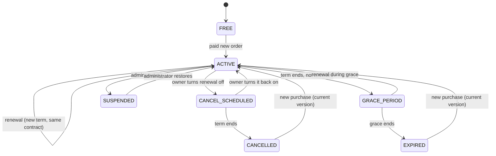

# Workspace subscriptions

Paid plans for study groups: Free, Plus, Pro and Team. Design decisions and their reasons are in
[`codementor-infra/database/docs/adr/0002-workspace-subscriptions.md`](https://github.com/codementor-official/codementor-infra/blob/main/database/docs/adr/0002-workspace-subscriptions.md);
this page covers behaviour, the API and operations.

## Business rules

| Rule | Where it is enforced |
| --- | --- |
| Prices and limits live in the database, never in code | `workspace_plan_versions` |
| A published version never changes | trigger `workspace_plan_version_guard` |
| A purchase keeps its limits and renewal price | snapshot columns on `workspace_subscriptions` + trigger `workspace_subscription_terms_immutable` |
| One open base subscription per account | unique index `workspace_subscriptions_one_open` |
| Paid periods never overlap | trigger `workspace_terms_no_overlap` |
| One open checkout per account | unique index `workspace_orders_one_pending` |
| Order prices never change after creation | trigger `workspace_order_terms_immutable` |
| Activation only after a verified payment | `SubscriptionsService.applyPayment` (provider IPN or gateway query) |
| Quotas hold under concurrency | advisory locks `ws-owner:<id>` / `ws-group:<id>` in workspace-service |
| Expiry or downgrade never deletes data | quotas only refuse operations that consume more |

## Plans and versions

- A **plan** (`workspace_plans`) is presentation: code, order, recommended badge, visible or hidden,
  sold or not. Exactly one plan is the default (Free).
- A **version** (`workspace_plan_versions`) holds prices, limits and feature flags. Editing a plan
  means saving a draft and publishing it; `available_from` can schedule it.
- The version **on sale** is the newest published one whose `available_from` has passed.
- Feature flags are a closed list (`priority_support`, `advanced_assignments`,
  `detailed_analytics`). The last two are marked *planned* and grant nothing yet.
- `monthly_ai_requests` is stored and shown as *not yet enforced*.

## Subscription lifecycle

The state is **derived from timestamps** (`subscriptionState()` in TypeScript and
`workspace_effective_entitlements()` in SQL — keep them in step). No job has to run for a
subscription to start, lapse or end.

| Change | When it takes effect | Price |
| --- | --- | --- |
| New subscription | immediately after payment | current version, coupon allowed |
| Renewal (same plan and cycle, while active, cancel-scheduled or in grace) | after `paid_through`, or now if lapsed | **contract price**, no coupon, even if the plan is hidden or archived |
| Upgrade (higher `sort_order`) | immediately; the old subscription ends with reason `upgraded` | current version minus the unused part of the current term (pro rata, whole VND, rounded down) and any prepaid term |
| Downgrade or cycle change | scheduled: renewal stops, the owner buys the new plan at the end of the period | nothing charged now |
| Cancel renewal | benefits continue to `paid_through`, then Free with no grace | no automatic refund |

An upgrade whose credit would leave less than 5,000 VND to pay is refused
(`WORKSPACE_PLAN_CHANGE_CONFLICT`): gateways cannot charge less.

## Checkout and payment

1. `POST /workspace-billing/quote` freezes the price, coupon, credit and limits in a quote.
2. `POST /workspace-billing/checkout` repeats the quote under the buyer's lock, refuses if the
   amount differs from `expectedAmountVnd` (`WORKSPACE_QUOTE_CHANGED`), creates the order, reserves
   the coupon and a `commerce_payments` row, and asks the gateway for a payment URL.
3. The gateway calls the existing course commerce webhooks. `OrdersService.apply` routes payments
   that carry a `workspace_order_id` to `SubscriptionsService.applyPayment`.
4. A success journals `clearing → platform`, creates the subscription (or the renewal term),
   redeems the coupon and notifies the owner — in one transaction.

Concurrent checkouts: the second request returns the same open order when the terms match, cancels
the first if its payment page was never opened, and is refused otherwise.

A payment that cannot be applied — it arrived after the order closed, the subscription changed, or
another subscription became active — is recorded and the order moves to `review`. The money is
never lost and entitlements are never merged.

## Quotas (workspace-service)

| Quota | Scope | Counted |
| --- | --- | --- |
| Owned groups | owner | every owned group, archived included |
| Members per group | group, using the owner's plan | active members, owner included; checked when a membership becomes active |
| Storage | owner, across owned groups | `group_documents.size_bytes` (trash included until purged) + unexpired upload reservations |
| File size | upload | owner's `max_upload_bytes`, the platform cap and the remaining storage |

Uploads reserve their size when the URL is signed (the size is part of the S3 signature). Confirming
the upload reads the real size from S3, releases the reservation and records the document in one
transaction. Expired reservations are swept every 10 minutes and their unconfirmed objects deleted
(`WORKSPACE_UPLOAD_JANITOR_ENABLED=false` turns this off).

Refusals return HTTP 422 with a specific `code` and `details` (`limit`, `used`, `requested`,
`available`, `plan`):

`WORKSPACE_GROUP_LIMIT_REACHED` · `WORKSPACE_MEMBER_LIMIT_REACHED` · `WORKSPACE_STORAGE_LIMIT_REACHED` ·
`WORKSPACE_FILE_SIZE_EXCEEDED` · `WORKSPACE_ENTITLEMENT_UNAVAILABLE`

Billing errors use `BUSINESS_RULE_VIOLATION` with `details.code`:
`WORKSPACE_PLAN_CHANGE_CONFLICT` · `WORKSPACE_QUOTE_CHANGED` · `WORKSPACE_COUPON_INVALID` ·
`WORKSPACE_SUBSCRIPTION_SUSPENDED` · `WORKSPACE_PLAN_DRAFT_CHANGED`.

Lecturers and administrators have no exemption.

## API

All paths are under `/api/v1`.

| Method | Path | Who |
| --- | --- | --- |
| GET | `/workspace-billing/plans` | public |
| GET | `/workspace-billing/subscription` | signed in |
| POST | `/workspace-billing/quote` · `/workspace-billing/checkout` | signed in |
| POST | `/workspace-billing/subscription/cancel` · `/resume` · `/schedule-change` | signed in |
| GET | `/workspace-billing/orders` · `/workspace-billing/orders/:id` | signed in (own orders) |
| POST | `/workspace-billing/orders/:id/reconcile` · `/mock` | signed in (mock only in mock mode) |
| GET | `/workspaces/plan-usage` | signed in |
| GET | `/workspace-billing/admin/overview` · `/plans` · `/plans/:id/versions` · `/subscribers` · `/subscribers/:userId` · `/orders` · `/coupons` · `/settings` · `/audit` | admin |
| POST/PATCH/PUT/DELETE | `/workspace-billing/admin/plans…` · `/subscribers/:userId/suspend|restore|adjustments` · `/adjustments/:id/revoke` · `/coupons…` · `/settings` | admin |
| GET | `/workspaces/plan-usage/admin-overview` | admin |

## Deployment order

1. **Database** (codementor-infra): back up, rehearse `0042_workspace_subscriptions.sql` inside
   `BEGIN … ROLLBACK`, apply it, record it in `infra_schema_migrations`
   ([ADR 0001](https://github.com/codementor-official/codementor-infra/blob/main/database/docs/adr/0001-manual-production-migrations.md)).
   Run `database/postgres/reports/workspace-quota-dry-run.sql` to see owners above Free limits.
2. **Backend**: deploy learning-service, workspace-service and Kong together (Kong routes
   `/api/v1/workspace-billing`). `npm run db:sync` is not required: the new code uses SQL directly.
3. **Frontend**: deploy client and admin.

**Rollback.** The application can be rolled back on its own: older code ignores the new tables,
and the only change to an existing table is `commerce_payments.order_id` becoming nullable plus a
new nullable column. Do not drop the new tables once a subscription has been paid.

## Operations

| Task | How |
| --- | --- |
| Verify unconfirmed payments | runs every minute when `COMMERCE_JOBS_ENABLED=true`; admins can press *Đối soát* on an order |
| Payments in `review` | inspect in Admin → Gói Workspace → Giao dịch and the audit log; refund through the gateway portal, then record the outcome |
| Give a customer extra room | Admin → Người đăng ký → Điều chỉnh ngoại lệ (time-boxed, reasoned, audited) |
| Change a price | edit the plan's draft and publish; existing subscribers keep their contract |
| Owners over their limit | Admin overview lists them; nothing is deleted |

## Not implemented yet

- Automatic recurring charges (the gateways are used for one-off payments only).
- Refund automation for subscription orders.
- Enforcement of `monthly_ai_requests`; `advanced_assignments` and `detailed_analytics`.
- Recipient acceptance before a group ownership transfer (the transfer is quota-checked and
  atomic, but immediate).
